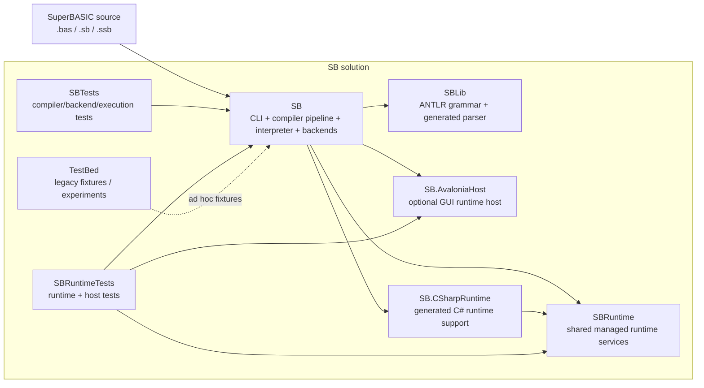
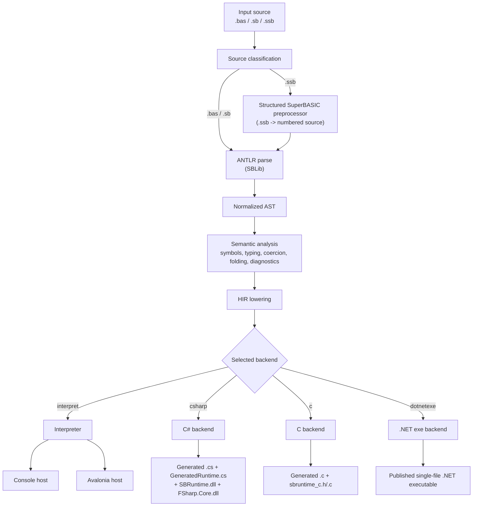

# SB Architecture

This document gives an overall view of the `SB` solution: the project-level structure and the active compiler/runtime pipeline.

## Solution Overview

## Active Pipeline

## Main Responsibilities

- `SB/Program.fs` handles CLI argument binding, appsettings fallback, and backend dispatch.
- `SB/CompilerPipeline.fs` coordinates source loading, preprocessing, parsing, semantic analysis, and HIR lowering.
- `SB/ParseTreeVisitor.fs` converts the ANTLR parse tree into the normalized AST.
- `SB/SemanticAnalyzer.fs` and related semantic modules resolve symbols, types, coercions, and diagnostics.
- `SB/AstToHir.fs` lowers the AST into HIR for execution or code generation.
- `SB/Interpreter.fs` executes HIR directly.
- `SB/HirCSharpBackend.fs` and `SB/HirCBackend.fs` emit alternate generated backends.
- `SBRuntime/` provides shared managed runtime behavior used by the interpreter and generated C# support.

## Notes

- `SB` is a modern language toolchain, not a Sinclair QL emulator.
- The interpreter is the most direct execution path and should be considered the reference runtime where backend parity is incomplete.
- Generated backends depend on copied runtime artifacts rather than reproducing the full interpreter stack.
